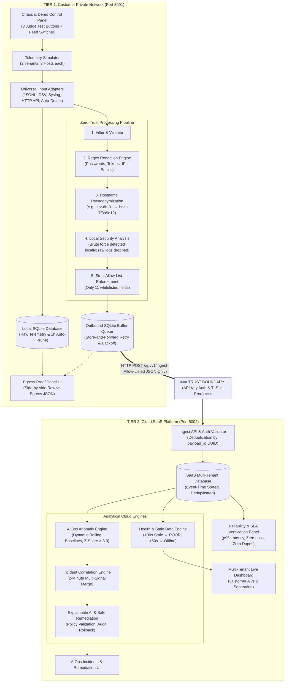

# SafeOps: Secure Two-Tier AIOps Observability Platform

SafeOps is a hackathon prototype designed for enterprise environments where **privacy and security are non-negotiable**. 

In conventional observability tools, sensitive internal hostnames, passwords, API tokens, and corporate network topology are routinely leaked to third-party cloud vendors. **SafeOps fixes this with a strict Two-Tier Zero-Trust Architecture:**

1. **Tier 1 (Customer-Side Collector, Port 8001):** Runs inside the customer's private network. It intercepts raw telemetry, strips secrets using regex, hashes hostnames into pseudonymous IDs (e.g., `host-7f3a9e12`), aggregates auth attacks locally, and buffers outgoing data in SQLite if the cloud connection is lost.
2. **Tier 2 (SaaS Cloud Platform, Port 8002):** Runs in the cloud. It ingests only the sanitized, allow-listed data, strictly isolates tenant data, detects anomalies using statistical dynamic baselines (3-sigma z-score), correlates events within 2 minutes into single actionable incidents, and provides safe, policy-checked remediation.

---

## Architecture & Trust Boundary Diagram



---

## Two-Tier Process Architecture & Multi-Machine Configuration

SafeOps runs as **two completely separate processes**, on **different ports**, each with its **own independent database**.

| Component | Default Port | Dedicated Database | Process Role |
| :--- | :--- | :--- | :--- |
| **Tier 1 (Customer Collector)** | **8001** | `collector_local.db` | Customer-side isolation, regex redaction, hostname pseudonymization, durable store-and-forward buffer queue. |
| **Tier 2 (SaaS Cloud Platform)** | **8002** | `saas_cloud.db` | Cloud ingestion API, multi-tenant isolation, AIOps dynamic 3-sigma anomaly correlation, SLA reliability accounting. |

Neither process touches the other's database. All communication crosses the trust boundary over HTTP with API key authentication.

### Running on One Machine (Two Separate Processes)

To launch both processes together on a single machine:
```bash
./start.sh
# or: ./start.sh both
```
This starts:
1. **Tier 2 SaaS Platform** as a background process on `0.0.0.0:8002` with `saas_cloud.db`.
2. **Tier 1 Customer Collector** as a background process on `0.0.0.0:8001` with `collector_local.db`.

Pressing `Ctrl+C` cleanly terminates both processes. Alternatively, run:
```bash
./stop.sh
```
to cleanly terminate all backend processes on ports 8001 and 8002.

### Making the SaaS Address a Config Setting (Moving to a Second Laptop)

The SaaS destination address is **not hardcoded**—it is a first-class configuration setting so you can seamlessly move the SaaS platform to a second laptop, edge node, or cloud VM.

#### Option 1: Config File (`config/collector_config.json`)
Edit `config/collector_config.json` and update `saas_url`:
```json
{
  "collector_version": "1.0.0-hackathon",
  "saas_url": "http://192.168.1.100:8002",
  "db_path": "collector_local.db"
}
```

#### Option 2: Environment Variable Override (`SAAS_URL`)
You can override the config file at runtime without editing any files:
```bash
export SAAS_URL="http://192.168.1.100:8002"
./start.sh collector
```

*(Note: If you omit `http://`, SafeOps automatically prepends it, and trailing slashes are automatically normalized).*

### Step-by-Step: Moving SaaS to a Second Laptop

```
┌────────────────────────────────┐         LAN / Wi-Fi HTTP         ┌────────────────────────────────┐
│      LAPTOP 1: CUSTOMER        │ ───────────────────────────────> │        LAPTOP 2: SAAS          │
│  Tier 1 Collector (Port 8001)  │    POST http://192.168.1.50:8002 │   Tier 2 SaaS (Port 8002)      │
│   DB: collector_local.db       │                                  │     DB: saas_cloud.db          │
└────────────────────────────────┘                                  └────────────────────────────────┘
```

1. **On Laptop 2 (SaaS Platform):**
   ```bash
   git clone <repo-url> SafeOps && cd SafeOps
   ./start.sh saas
   # or: ./start_saas.sh
   ```
   *SaaS starts listening on `0.0.0.0:8002` with database `saas_cloud.db`.* Note Laptop 2's LAN IP address (e.g., `192.168.1.50`).

2. **On Laptop 1 (Customer Collector):**
   Open `config/collector_config.json` and set:
   ```json
   "saas_url": "http://192.168.1.50:8002"
   ```
   *(Or set `export SAAS_URL="http://192.168.1.50:8002"` in your terminal).*
   
   Then start the collector:
   ```bash
   ./start.sh collector
   # or: ./start_collector.sh
   ```
   *Collector starts listening on `0.0.0.0:8001` with database `collector_local.db`, and automatically streams all egress payloads and heartbeats over the LAN to Laptop 2!*


At the hackathon or in real enterprise deployments, telemetry streams arrive in many different shapes. **SafeOps uses JSON Lines by default for our simulator, but the input adapter allows you to switch data sources instantly without modifying any downstream code.**

### 3 Easy Ways to Switch Formats

#### 1. Change One Setting in Config File (`config/collector_config.json`)
Open `config/collector_config.json` and change `"input_format"`:
```json
{
  "input_format": "simulator",
  "feed_file_path": "data_feed/telemetry_input.data"
}
```
Options for `"input_format"`:
* `"simulator"` &rarr; **Default**: Procedural JSON Lines engine generating live Customer A & B metrics.
* `"csv"` &rarr; Tails a CSV file. Supports auto-mapping column aliases (`host`/`server`, `cpu`/`val`, `log`/`msg`).
* `"syslog"` &rarr; Tails standard Syslog streams (RFC 5424 structured headers or RFC 3164 BSD legacy logs).
* `"jsonl"` &rarr; Tails any external JSON Lines / NDJSON file.
* `"http"` &rarr; Receives telemetry pushed over HTTP REST webhook.
* `"auto"` &rarr; Adaptive sniffer: examines the stream and automatically parses whichever format arrives.

#### 2. Switch Live from the Web UI (Zero Restart Required)
1. Go to the **Chaos & Demo Control Panel**: [http://127.0.0.1:8001/control](http://127.0.0.1:8001/control).
2. Look at the top card: **"Telemetry Input Adapter & Feed Format"**.
3. Pick any format from the dropdown, or click the 1-click test buttons:
   * **📂 Load Sample CSV**: Instantly loads sample CSV columns with metric readings.
   * **📂 Load Sample Syslog**: Instantly streams RFC 5424 Syslog messages.
   * **📂 Load Sample JSONL**: Streams raw JSON records.
   * **🔄 Reset to Simulator**: Returns back to continuous live simulated feeds.

#### 3. Stream Directly via HTTP API (`curl`)
Judges and organizers can stream external telemetry directly to the collector via HTTP POST:
```bash
# Push JSON Line
curl -X POST http://127.0.0.1:8001/api/v1/adapter/push \
  -H "Content-Type: application/json" \
  -d '{"tenant_id": "tenant-a", "hostname": "web-01", "metric": "cpu_usage_pct", "value": 94.2}'

# Push CSV Row
curl -X POST http://127.0.0.1:8001/api/v1/adapter/push \
  -H "Content-Type: text/csv" \
  -d 'tenant_id,hostname,metric,value\ntenant-a,srv-app-01,memory_usage_pct,88.0'

# Push Syslog Message
curl -X POST http://127.0.0.1:8001/api/v1/adapter/push \
  -H "Content-Type: text/plain" \
  -d '<134>1 2026-11-20T10:00:00Z srv-db-01 SafeOps - - tenant=tenant-b metric=latency_ms value=240.0'
```

Whichever format is used, Tier 1 automatically parses the record, strips secrets, pseudonymizes the host, enforces the 11 allow-listed egress fields, and buffers the payload to Tier 2 SaaS.

---

## Quick Start (Run on One Laptop with One Command)

SafeOps requires **no complex setup**, no Docker, and no heavy node modules. It runs with standard Python 3.11+.

### On Mac or Linux:
Open Terminal, navigate to the folder, and run:
```bash
./start.sh
```

### On Windows:
Double-click `start.bat` or run in Command Prompt:
```cmd
start.bat
```

The script will automatically create a Python virtual environment (`.venv`), install required packages (`fastapi`, `uvicorn`, `httpx`, `pydantic`, `psutil`), and launch both applications.

---

## Live Web Dashboards

Once started, open these links in your web browser:

| Tier | Purpose | URL |
| :--- | :--- | :--- |
| **Tier 1** | **Egress Proof Panel** (Side-by-side proof that secrets never leave) | [http://127.0.0.1:8001/egress](http://127.0.0.1:8001/egress) |
| **Tier 1** | **Chaos & Demo Controls** (Inject spikes, attacks, outages) | [http://127.0.0.1:8001/control](http://127.0.0.1:8001/control) |
| **Tier 2** | **SaaS Cloud Dashboard** (Multi-tenant metrics & health) | [https://127.0.0.1:8002/dashboard](https://127.0.0.1:8002/dashboard) |
| **Tier 2** | **AIOps Incidents & Remediation** (Correlated root cause & approval) | [https://127.0.0.1:8002/incidents](https://127.0.0.1:8002/incidents) |
| **Tier 2** | **Reliability & SLA Panel** (p95 latency, zero loss, zero dupes) | [https://127.0.0.1:8002/reliability](https://127.0.0.1:8002/reliability) |

---

## Step-by-Step Judge Walkthrough (Live Scenarios)

Use the **Chaos & Demo Controls page** (`http://127.0.0.1:8001/control`) to trigger scenarios and verify the behavior in real time on the live dashboards.

### Pre-Demo Setup (Open 3 Browser Tabs)
1. **Customer Perimeter (Tier 1):** `http://127.0.0.1:8001/control` (Controls) & `http://127.0.0.1:8001/egress` (Egress Proof)
2. **SaaS Cloud Platform (Tier 2):** `https://127.0.0.1:8002/dashboard` (Fleet Health)
3. **SaaS Reliability & Incidents:** `https://127.0.0.1:8002/incidents` & `https://127.0.0.1:8002/reliability`

---

### Scenario 1: CPU Spike & Dynamic Baseline Anomaly (Infra Alert)
* **What it does:** Injects severe compute load breaching the statistical 3-sigma baseline.
* **How to demo:**
  1. In Demo Control (`http://127.0.0.1:8001/control`), click **"1. Inject CPU Spike"**.
  2. Switch to **SaaS Dashboard** (`https://127.0.0.1:8002/dashboard`).
  3. **What to point at on screen:** Point at the target Host Health status badge transitioning in real-time from `EXCELLENT` (green) to `POOR` (red), with the reason badge citing dynamic CPU saturation beyond baseline.
  4. Switch to **AIOps Incidents** (`https://127.0.0.1:8002/incidents`). Point at the incident card titled *"Resource: CPU anomaly on host-5a29f93e"* showing dynamic statistical confidence %, likely cause, and suggested throttling action.

### Scenario 2: Network Latency Rise (Network Path Degradation)
* **What it does:** Drives round-trip network latency up beyond the baseline threshold.
* **How to demo:**
  1. In Demo Control, click **"2. Inject Latency Rise"**.
  2. Switch to **SaaS Dashboard**.
  3. **What to point at on screen:** Point at the live latency value flashing yellow/red, and point at the Event History table logging the exact UTC state transition. Point at the incident card on AIOps Incidents titled *"Network degradation: latency surge on host-5a29f93e"*. Notice healthy hosts do NOT trigger false alarms.

### Scenario 3: Packet Loss Injection & Multi-Signal Correlation
* **What it does:** Injects network link packet loss on the same host while latency is elevated.
* **How to demo:**
  1. Click **"3. Inject Packet Loss"** while Latency is still elevated.
  2. Switch to **AIOps Incidents**.
  3. **What to point at on screen:** Point at how SafeOps correlates both signals into a single unified incident titled *"Network degradation: latency + packet loss on host-5a29f93e"* (showing "2 independent signals") instead of firing duplicate alert noise.

### Scenario 4: Repeated Failed Logins (Edge Security Analysis)
* **What it does:** Simulates rapid failed authentication attempts (brute-force attack).
* **The Privacy Guarantee:** Tier 1 analyzes authentication logs **locally**. It summarizes the attack and sends ONLY a count and risk level. **Zero raw log lines, usernames, or passwords ever leave the customer premises.**
* **How to demo:**
  1. Click **"4. Inject Brute-Force Logins"** in Demo Control.
  2. Switch to **Egress Proof Panel** (`http://127.0.0.1:8001/egress`).
  3. **What to point at on screen:** Point at the left table showing raw auth failure logs marked `BLOCKED (Retained locally in SQLite)`. Point at the right table showing outbound egress containing only sanitized metadata (`metric: failed_logins`).
  4. Switch to **AIOps Incidents**: Point at the distinct Security incident titled *"Security: repeated failed logins on host-5a29f93e"* with recommended rate-limiting firewall rule. Notice it is kept strictly separate from infra/network incidents.

### Scenario 5: Secret in Log Line (Zero-Trust Egress Redaction)
* **What it does:** Injects credentials, API tokens, internal IP addresses, and employee emails into the log stream.
* **How to demo:**
  1. Click **"5. Inject Credentials in Log"** in Demo Control.
  2. Switch to **Egress Proof Panel**.
  3. **What to point at on screen:** Point at the red highlighted tokens in the local input column, and point at the green redacted placeholders in the outbound egress column (`[REDACTED_API_KEY]`, `[REDACTED_PASSWORD]`, `[REDACTED_IP]`). Point at the `SECRETS INTERCEPTED LOCALLY` counter incrementing.

### Scenario 6: Service Down & Auto-Recovery Policy
* **What it does:** Simulates a daemon termination (`service_status = 0`).
* **How to demo:**
  1. In Demo Control, click **"6. Terminate Service (DOWN)"**.
  2. Switch to **SaaS Dashboard**.
  3. **What to point at on screen:** Point at the target host card immediately marking service status offline.
  4. Switch to **AIOps Incidents**: Point at the incident card titled *"Availability: service outage on host-5a29f93e"* and the auto-recovery recommendation verifying automated restart authorization.

### Scenario 7: SaaS Cloud Outage & Resilient Buffer Queue (Store-and-Forward)
* **What it does:** Simulates complete severance of the network link between Collector and SaaS.
* **How to demo:**
  1. In Demo Control, click **"7. Simulate SaaS Outage / Network Sever"**.
  2. Switch to **Egress Proof Panel**.
  3. **What to point at on screen:** Point at the **"Pending Outbound Buffer"** counter continuously incrementing as telemetry safely queues in local SQLite without data loss.
  4. Click the button again to restore connectivity.
  5. **What to point at on screen:** Watch the buffer instantly drain to 0. Switch to the **Reliability Page** (`https://127.0.0.1:8002/reliability`) and point at **Lost Payloads: 0** and **Delivery SLA: 100.00%**.

### Scenario 8: Duplicate & Out-of-Order Event Rejection
* **What it does:** Replays previously sent payload UUIDs and injects timestamp-delayed events.
* **How to demo:**
  1. In Demo Control, click **"8. Inject Duplicates / Out-of-Order"**.
  2. Switch to **Reliability Page**.
  3. **What to point at on screen:**
     - Point at **"Duplicates Detected & Rejected"** incrementing (0 accepted, proof of UUID deduplication).
     - Point at **"Out-of-Order / Reordered Events"** incrementing.
     - Point at the chronological event feed maintaining strict timestamp ordering without chart corruption.

### Scenario 9: Collector Heartbeat Pause (Measured Offline Detection)
* **What it does:** Pauses the background heartbeat loop to demonstrate dead-man switch detection.
* **How to demo:**
  1. In Demo Control, click **"9. Stop Collector Heartbeat"**.
  2. Switch to **SaaS Dashboard**.
  3. **What to point at on screen:** Wait for the 45s timeout to elapse. Point at the **Collector Status Beacon** transitioning to red (*"Collector OFFLINE (POOR)"*), showing the measured detection duration (e.g. `46.2s`, comfortably meeting the < 60s SLA).

---

## Safe Remediation Workflow (Simulated)

SafeOps ensures automated recommendations cannot accidentally take down production systems:
1. **Policy Check:** Every incident checks against automated remediation policies (e.g., *"APPROVED: Auto-recovery policy permits restarting host service container"* vs. *"MANUAL_APPROVAL_REQUIRED: Infrastructure change policy requires authorization to scale CPU quota"*).
2. **Approve / Reject Buttons:** SREs can approve execution directly in the UI. Point at the immutable audit log entry created with operator name, policy reason, and UTC timestamp.
3. **Rollback Option:** Click **"Rollback Remediation"**. Point at the incident state transitioning back to `OPEN` and the rollback audit record permanently logged.

---

## Reset Demo Data (Clean State)
Click the **"Reset Demo Data"** button in the top navigation bar of either the Control Panel or Reliability page. Both SQLite databases (`collector_local.db` and `saas_cloud.db`), telemetry queues, incidents, and counters are cleared back to 0.

---

## Tenant Isolation Guarantee

SafeOps enforces cryptographic and database isolation between tenants:
- **Tenant A (Customer A - Financial Cloud)**: API Key `sec_key_tenant_a_998811`
- **Tenant B (Customer B - Healthcare Core)**: API Key `sec_key_tenant_b_443322`
- The SaaS platform verifies API keys on ingest and strictly partitions all queries with `WHERE tenant_id = ?`.
- In the dashboard, switching between Tenant A and Tenant B proves Tenant A can never view Tenant B's hosts or metrics.

---

## Global-Ready Design (5 Core Pillars)

SafeOps is engineered from the ground up to operate across sovereign jurisdictions, multiple cloud regions, and global timezones:

| Pillar | Architectural Principle | SafeOps Implementation & Enforcement |
| :--- | :--- | :--- |
| **1. Regional Ingest** | Collectors send to the nearest or assigned regional endpoint to reduce latency and respect jurisdiction. | `BufferSender` dynamically resolves tenant residency mapping against `regional_endpoints` (`us-east-1`, `eu-central-1`, `ap-southeast-1`). Outbound batches carry `X-Region-ID` and `X-Jurisdiction` egress headers. |
| **2. Tenant Data Residency** | Each tenant's metadata is stored in its chosen region and never replicated elsewhere without policy approval. | Tenants are pinned to sovereign home regions (`tenant-a` &rarr; `us-east-1` / `US-Domestic`; `tenant-b` &rarr; `eu-central-1` / `EU-GDPR`). Cross-region replication attempts return `403 Forbidden: DATA_RESIDENCY_VIOLATION` and are recorded in `residency_audit_log`, unless approved by a signed DPO token (`POL_APPR_*`). |
| **3. UTC Timestamps & Timezones** | All events carry UTC time plus a source timezone so dashboards render correctly worldwide. | Payloads use canonical ISO-8601 UTC timestamps (`event_time_utc`) along with `source_timezone` (`America/New_York`, `Europe/Frankfurt`), enabling accurate multi-region temporal aggregation and localized dashboard views. |
| **4. Out-of-Order Handling** | Late or reordered events are placed by event time, not arrival time, without corrupting trends. | The SaaS storage engine indexes records by epoch `event_ts`. Latest host state queries use `MAX(event_ts)`, ensuring delayed packets arriving after an outage slot into their proper historical position without overwriting current health states. |
| **5. Idempotent Delivery** | Every payload has a unique ID so retries after outages never create duplicates. | Every payload is minted with a unique UUID `payload_id` as the database primary key. Replayed packets or retried buffer batches are dropped idempotently with `0 accepted`, incrementing `duplicates_rejected` counters. |

### Testing & Auditing Global-Ready Design
- **Interactive UI Verification:** Open `http://127.0.0.1:8002/reliability` to inspect the 5 Global-Ready pillars, run a live cross-region replication probe, and review recent sovereign audit logs.
- **Automated Test Suite:** Run `python3 -m unittest tests/test_global_ready_design.py -v` to verify all 5 pillars programmatically in sub-second execution.

---

## Production Limitations & Roadmap

As a hackathon prototype running locally on a single machine, SafeOps has the following known design trade-offs:

1. **Transport Layer Security (TLS):** For local demo simplicity, Tier 1 and Tier 2 communicate over plaintext HTTP on `127.0.0.1`. In production, this channel would mandate **mutual TLS (mTLS)** with client and server x509 certificates to encrypt all data in transit and prevent man-in-the-middle attacks.
2. **Storage Engine:** SQLite is utilized for single-file, zero-configuration local execution. In production, Tier 1 would use a local embedded WAL database or disk ring buffer, and Tier 2 would use distributed PostgreSQL with TimescaleDB or Apache Kafka.
3. **Remediation Execution:** Remediation actions (e.g., container restarts, route changes) are simulated with policy checks and state mutations rather than live Kubernetes or AWS API calls.
4. **Single-Region Topology:** The prototype runs both tiers on one host. In production, Tier 1 collectors deploy as daemonsets across customer Kubernetes clusters or edge VPCs, while Tier 2 deploys in a multi-region cloud topology.
